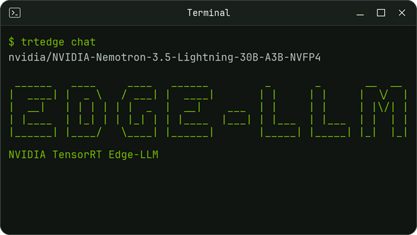

<div align="center">

# TensorRT Edge-LLM


**High-Performance Large Language Model Inference Framework for NVIDIA Edge Platforms**

[](https://nvidia.github.io/TensorRT-Edge-LLM/)
[](https://github.com/NVIDIA/TensorRT-Edge-LLM/blob/main/tensorrt_edgellm/_version.py)
[](https://github.com/NVIDIA/TensorRT-Edge-LLM/blob/main/LICENSE)

<p align="center">
  
</p>

[Overview](https://nvidia.github.io/TensorRT-Edge-LLM/latest/overview.html)&nbsp;&nbsp;&nbsp;|&nbsp;&nbsp;&nbsp;[Support Matrix](https://nvidia.github.io/TensorRT-Edge-LLM/latest/user_guide/getting_started/support-matrix.html)&nbsp;&nbsp;&nbsp;|&nbsp;&nbsp;&nbsp;[Quick Start](https://nvidia.github.io/TensorRT-Edge-LLM/latest/user_guide/getting_started/quick-start-guide.html)&nbsp;&nbsp;&nbsp;|&nbsp;&nbsp;&nbsp;[Performance](https://nvidia.github.io/TensorRT-Edge-LLM/latest/user_guide/performance/performance-benchmarks.html)&nbsp;&nbsp;&nbsp;|&nbsp;&nbsp;&nbsp;[Documentation](https://nvidia.github.io/TensorRT-Edge-LLM/)&nbsp;&nbsp;&nbsp;|&nbsp;&nbsp;&nbsp;[Roadmap](https://github.com/NVIDIA/TensorRT-Edge-LLM/issues?q=is%3Aissue%20state%3Aopen%20label%3ARoadmap)

---
<div align="left">

## Latest News

- **[2026/09]** [TensorRT Edge-LLM completes the MLPerf Edge Agentic benchmark 6.4x faster on Jetson AGX Thor](https://developer.nvidia.com/blog/tensorrt-edge-llm-completes-the-mlperf-edge-agentic-benchmark-6-4x-faster-on-jetson-agx-thor/).
- **[2026/09]** Release **0.11.0** adds [published Python wheels](docs/source/user_guide/getting_started/installation.md#published-python-wheel), [Muse-Glimmer](https://huggingface.co/meta-models/Muse-Glimmer-30B), experimental [pi0.5](docs/source/user_guide/examples/vla/pi05.md), Hunyuan dense models, [guided decoding](docs/source/user_guide/examples/server.md#structured-output), opt-in [in-flight batching](docs/source/user_guide/features/in-flight-batching.md), native provider Jinja chat templates, and GPU-free CuTe DSL artifact generation.
- **[2026/09]** Release **0.10.1** adds experimental [**TP=2 inference on Dual NVIDIA DGX Spark**](docs/source/user_guide/features/multi-device.md) and redesigns the experimental [OpenAI-compatible server](docs/source/user_guide/examples/server.md) for faster cold launches and lower memory usage.
- **[2026/08]** TensorRT Edge-LLM **0.10.0** adds Day-0 support for [**Qwen3.8-27B**](https://huggingface.co/Qwen/Qwen3.8-27B).
- **[2026/08]** Release **0.10.0** adds support for [**NVIDIA Nemotron-3.5 Lightning**](https://huggingface.co/nvidia/NVIDIA-Nemotron-3.5-Lightning-30B-A3B-NVFP4) with **MTP** and **DFlash**, [**Cosmos3-Edge**](https://huggingface.co/nvidia/Cosmos3-Edge), [**DiffusionGemma**](https://huggingface.co/nvidia/diffusiongemma-26B-A4B-it-NVFP4), [**Nemotron-3.5-ASR**](https://huggingface.co/nvidia/nemotron-3.5-asr-streaming-0.6b), and [**DSpark**](docs/source/user_guide/examples/speculative-decoding.md#dspark) speculative decoding, alongside an experimental [direct TensorRT engine builder](docs/source/user_guide/getting_started/direct-engine-builder.md) without ONNX export, multi-turn KV-cache reuse, and video input for the experimental OpenAI-compatible server.
- **[2026/07]** Support for the full **Gemma 4** family (E2B / E4B / 12B / 26B-A4B / 31B — multimodal text + image + audio, with MTP), **Qwen3-Omni** and **Nemotron-3** NVFP4, and **DFlash** speculative decoding (with DDTree for Qwen3 / Qwen3.5) landed across releases 0.9.0 and 0.9.1.

---

## Overview

TensorRT Edge-LLM is NVIDIA's C++ inference runtime for text, vision, audio, speech, and action models on NVIDIA Jetson, NVIDIA DRIVE, and NVIDIA DGX Spark. The supported frontend exports Hugging Face checkpoints to [ONNX](https://onnx.ai) for C++ engine building; an experimental direct frontend builds engines from checkpoints without ONNX. Both paths use the same C++ deployment runtimes.

---

## Getting Started

For a supported target, install a [published Python wheel](docs/source/user_guide/getting_started/installation.md#published-python-wheel)
without compiling Edge-LLM. Use `tensorrt-edgellm[runtime]` for the high-level
Python API and HTTP serving. See [Optional Python dependencies](docs/source/user_guide/getting_started/installation.md#optional-python-dependencies)
for additional tools, or [Install without optional dependencies](docs/source/user_guide/getting_started/installation.md#install-without-optional-dependencies)
for the base installation.

Follow the [Quick Start Guide](docs/source/user_guide/getting_started/quick-start-guide.md)
to start a chat or send an inference request. Checkpoint IDs are listed in
[Supported Models](docs/source/user_guide/getting_started/supported-models.md).

Install from PyPI (requires a supported CUDA/TensorRT stack):

```bash
python -m pip install "tensorrt-edgellm[runtime]"
```

---

## Use with coding agents

The repository ships agent skills in [`skills/`](skills/README.md). Agent hosts
that support `.agents/skills` (including Codex and Cursor) discover them inside
a clone; Claude Code uses the `.claude/skills` link. Set up the project and let
the agent drive:

```bash
git clone https://github.com/NVIDIA/TensorRT-Edge-LLM.git && cd TensorRT-Edge-LLM
claude "Set up TensorRT Edge-LLM on this machine with the edge-llm-install skill. Ask before system-wide changes."   # or: codex "..."
```

To use the skills outside a clone, ask: `Install the Edge-LLM agent skills for <Claude Code|Codex> with the edge-llm-install skill.`

Each skill states the inputs it needs and the evidence it reports before it declares success.

| Task | Example prompt | Skill |
|---|---|---|
| Install, update, or remove | `Install Edge-LLM from a wheel on this Jetson Thor and verify it.` | [`edge-llm-install`](skills/edge-llm-install/SKILL.md) |
| Serve a model | `Serve <org/model> through the OpenAI-compatible API, send a streaming request, and stop it after the smoke test.` | [`edge-llm-serve`](skills/edge-llm-serve/SKILL.md) |
| Convert and run a model | `Export <org/model>, build the required engines, run C++ inference, and compare with the provider reference.` | [`edge-llm-convert-model`](skills/edge-llm-convert-model/SKILL.md) |
| Add or customize a model | `Add support for <org/model>; start from its config.json and checkpoint tensors.` | [`edge-llm-add-model`](skills/edge-llm-add-model/SKILL.md) |
| CuTe DSL kernel | `Add a CuTe DSL kernel variant for sm_<NN> and validate it on freshly generated artifacts.` | [`edge-llm-cutedsl-kernel`](skills/edge-llm-cutedsl-kernel/SKILL.md) |
| TensorRT plugin | `Add a TensorRT plugin for <op> to both frontends.` | [`edge-llm-plugin-extension`](skills/edge-llm-plugin-extension/SKILL.md) |
| Upgrade or backport | `Migrate my deployment from Edge-LLM <old> to <new>.` | [`edge-llm-version-migration`](skills/edge-llm-version-migration/SKILL.md) |
| Accuracy mismatch | `Output differs from the Hugging Face reference; find the first failing layer.` | [`edge-llm-few-layer-test`](skills/edge-llm-few-layer-test/SKILL.md), then [`edge-llm-accuracy-debugging`](skills/edge-llm-accuracy-debugging/SKILL.md) |
| Run or add tests | `Add an end-to-end case for <org/model> and run only that case.` | [`edge-llm-e2e-test`](skills/edge-llm-e2e-test/SKILL.md), [`edge-llm-cpp-test`](skills/edge-llm-cpp-test/SKILL.md) |

Not sure which skill applies? Ask the agent to list the skills in `skills/` and pick one.

---

## Documentation

### Introduction

- **[Overview](https://nvidia.github.io/TensorRT-Edge-LLM/latest/overview.html)** - What is TensorRT Edge-LLM and key features
- **[Official Support Matrix](https://nvidia.github.io/TensorRT-Edge-LLM/latest/user_guide/getting_started/support-matrix.html)** - Platform, JetPack, DriveOS, CUDA, TensorRT, and TensorRT Edge-LLM compatibility
- **[Supported Models](https://nvidia.github.io/TensorRT-Edge-LLM/latest/user_guide/getting_started/supported-models.html)** - Complete model compatibility matrix
- **[Checkpoint Exporter](https://nvidia.github.io/TensorRT-Edge-LLM/latest/developer_guide/software-design/checkpoint-export.html)** - Recommended ONNX export pipeline
- **[Experimental Direct Engine Builder](https://nvidia.github.io/TensorRT-Edge-LLM/latest/user_guide/getting_started/direct-engine-builder.html)** - Build all model components directly from a checkpoint

### User Guide

- **[Installation](https://nvidia.github.io/TensorRT-Edge-LLM/latest/user_guide/getting_started/installation.html)** - Set up quantization, `tensorrt_edgellm`, and the C++ runtime
- **[trtedge CLI](docs/source/user_guide/getting_started/cli.md)** - Chat, serve models, build engines, export ONNX, and prepare checkpoints
- **[Quick Start Guide](https://nvidia.github.io/TensorRT-Edge-LLM/latest/user_guide/getting_started/quick-start-guide.html)** - Run your first inference in ~15 minutes
- **[Examples](https://nvidia.github.io/TensorRT-Edge-LLM/latest/user_guide/examples/index.html)** - End-to-end workflows
- **[Quantization](https://nvidia.github.io/TensorRT-Edge-LLM/latest/user_guide/features/quantization.html)** - Create quantized checkpoints for `tensorrt_edgellm`
- **[Python API and OpenAI-Compatible Server](https://nvidia.github.io/TensorRT-Edge-LLM/latest/user_guide/examples/server.html)** - vLLM-style API and OpenAI-compatible server
- **[Input Format Guide](https://nvidia.github.io/TensorRT-Edge-LLM/latest/user_guide/format/input-format.html)** - Request format and specifications
- **[Chat Template Format](https://nvidia.github.io/TensorRT-Edge-LLM/latest/user_guide/format/chat-template-format.html)** - Chat template configuration

### Developer Guide

#### Software Design

- **[Quantization Package Design](https://nvidia.github.io/TensorRT-Edge-LLM/latest/developer_guide/software-design/quantization-design.html)** - Quantization package architecture
- **[Engine Builder](https://nvidia.github.io/TensorRT-Edge-LLM/latest/developer_guide/software-design/engine-builder.html)** - Building TensorRT engines
- **[C++ Runtime Overview](https://nvidia.github.io/TensorRT-Edge-LLM/latest/developer_guide/software-design/cpp-runtime-overview.html)** - Runtime system architecture
  - [LLM Inference Runtime](https://nvidia.github.io/TensorRT-Edge-LLM/latest/developer_guide/software-design/llm-inference-runtime.html)

#### Advanced Topics

- **[Customization Guide](https://nvidia.github.io/TensorRT-Edge-LLM/latest/developer_guide/customization/customization-guide.html)** - Customizing TensorRT Edge-LLM for your needs
- **[TensorRT Plugins](https://nvidia.github.io/TensorRT-Edge-LLM/latest/developer_guide/customization/tensorrt-plugins.html)** - Custom plugin development
- **[Tests](tests/)** - Comprehensive test suite for contributors

---

## Performance

See the [**Performance Benchmarks**](https://nvidia.github.io/TensorRT-Edge-LLM/latest/user_guide/performance/performance-benchmarks.html) page for released benchmark results covering LLM and VLM prefill, generation throughput, memory usage, and EAGLE speculative decoding speedups.

---

## Use Cases

**🚗 Automotive**
- In-vehicle AI assistants
- Voice-controlled interfaces
- Scene understanding
- Driver assistance systems

**🤖 Robotics**
- Natural language interaction
- Task planning and reasoning
- Visual question answering
- Human-robot collaboration

**🏭 Industrial IoT**
- Equipment monitoring with NLP
- Automated inspection
- Predictive maintenance
- Voice-controlled machinery

**📱 Edge Devices**
- On-device chatbots
- Offline language processing
- Privacy-preserving AI
- Low-latency inference

---

## Featured Websites

- [TensorRT Edge-LLM Jetson AI Lab tutorial](https://www.jetson-ai-lab.com/tutorials/tensorrt-edge-llm/)
- [Run AI Models for Edge Application Development with Just a Few Commands](https://developer.nvidia.com/blog/run-ai-models-for-edge-application-development-with-just-a-few-commands/)
- [Maximizing Memory Efficiency to Run Bigger Models on NVIDIA Jetson](https://developer.nvidia.com/blog/maximizing-memory-efficiency-to-run-bigger-models-on-nvidia-jetson/)
- [Build Next-Gen Physical AI with Edge-First LLMs for Autonomous Vehicles and Robotics](https://developer.nvidia.com/blog/build-next-gen-physical-ai-with-edge%E2%80%91first-llms-for-autonomous-vehicles-and-robotics/)
- [Accelerate AI Inference for Edge and Robotics with NVIDIA Jetson T4000 and NVIDIA JetPack 7.1](https://developer.nvidia.com/blog/accelerate-ai-inference-for-edge-and-robotics-with-nvidia-jetson-t4000-and-nvidia-jetpack-7-1/)
- [Accelerating LLM and VLM Inference for Automotive and Robotics with NVIDIA TensorRT Edge-LLM](https://developer.nvidia.com/blog/accelerating-llm-and-vlm-inference-for-automotive-and-robotics-with-nvidia-tensorrt-edge-llm/)

Follow our [GitHub repository](https://github.com/NVIDIA/TensorRT-Edge-LLM) for the latest updates, releases, and announcements.

---

## Support

- **Documentation**: [Full Documentation](https://nvidia.github.io/TensorRT-Edge-LLM/)
- **Quick Start**: [Quick Start Guide](https://nvidia.github.io/TensorRT-Edge-LLM/latest/user_guide/getting_started/quick-start-guide.html)
- **Roadmap**: [Developer Roadmap](https://github.com/NVIDIA/TensorRT-Edge-LLM/issues?q=is%3Aissue%20state%3Aopen%20label%3ARoadmap)
- **Issues**: [GitHub Issues](https://github.com/NVIDIA/TensorRT-Edge-LLM/issues)
- **Discussions**: [GitHub Discussions](https://github.com/NVIDIA/TensorRT-Edge-LLM/discussions)
- **Forums**: [NVIDIA Developer Forums](https://forums.developer.nvidia.com/)

---

## License

[Apache License 2.0](LICENSE)

---

## Contributing

We welcome contributions! Please see our [Contributing Guidelines](CONTRIBUTING.md) for details.

---
