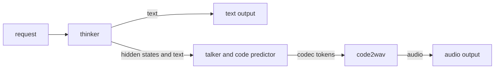

# Multi-Stage Graph

Qwen3-Omni runs several engines for one request: a thinker (the LLM backbone)
that writes the text reply, a talker and its code predictor that turn the reply
into codec tokens, a vocoder (code2wav) that turns codec tokens into audio, and
the audio and visual encoders in front of the thinker. Qwen3-TTS has no thinker;
its talker speaks the text it is given. The multi-stage graph records which
engines a deployment has, and which output feeds which input, in one file,
`multistage_config.json`, that the builder writes next to the engines.
`multistage_inference` loads that file and runs requests through it.

A build whose only components are an `llm` and its audio or visual encoders gets
a one-stage graph, so LLMs, VLMs, and ASR models also run through
`multistage_inference`. MiniMax-H3 runs its text encoder, denoiser, and audio
and video decoders as a graph too; see [MiniMax-H3](../../user_guide/examples/minimax-h3.md).



## Build the engines

The experimental `tensorrt-edgellm-build` writes `multistage_config.json` into
`--engine-dir` after it builds the components:

```bash
tensorrt-edgellm-build --model-dir $CKPT --engine-dir $ENG \
    --max-input-len 1024 --max-kv-cache-capacity 4096 --max-batch-size 4
```

`--max-batch-size` caps how many requests run together; see
[Batch requests](#batch-requests).

Engines from the supported workflow, `tensorrt-edgellm-export` and the C++
builders, come without a graph. To write one for the engines already in `$ENG`
without building anything, run:

```bash
tensorrt-edgellm-build --graph-only --model-dir $CKPT --engine-dir $ENG
```

It looks for the backbone in `$ENG`, `$ENG/thinker`, or `$ENG/llm`, for the
encoders in `audio/` and `visual/` under `$ENG` or `$ENG/multimodal`, and for
every other engine in its own subdirectory, such as `$ENG/talker`,
`$ENG/code_predictor`, and `$ENG/code2wav`. An engine anywhere else is left out
of the graph.

The builder writes no graph, and logs why, for a tensor-parallel build, a
`qwen3_omni_moe` build without its `llm` component, or a build
with a component that no stage runs, such as an action expert.

## Run requests

Run one request from the command line:

```bash
# Text in; the reply on stdout and the speech in hello.wav.
./build/bin/multistage_inference --config $ENG --prompt "Hello" --out-audio hello.wav

# Audio in.
./build/bin/multistage_inference --config $ENG --audio question.wav --out-audio answer.wav
```

Without `--out-audio`, or `--output-audio-dir` for a request file, only the stages
that produce text run, so a speech model answers in text and skips the talker
and the vocoder. A graph without a text output, such as Qwen3-TTS, always runs
its speech stages. `--voice SPEAKER` selects one of the checkpoint's speakers.

Run a request file:

```bash
./build/bin/multistage_inference --config $ENG --input-file requests.json \
    --output-file predictions.json --output-audio-dir out --batch-size 4
```

The request file has the format that `llm_inference` reads (see
[Input format](../../user_guide/format/input-format.md)) or, for Qwen3-TTS, the
format that `qwen3_tts_inference` reads (see
[TTS input file format](../../user_guide/examples/tts.md#input-file-format)).
Each entry in `predictions.json` has the fields `llm_inference` writes, the
audio fields of `qwen3_tts_inference` for speech, and `ok`, `error`, and
per-stage details in `stages`. `--output-audio-dir` receives `audio_req<i>.wav`
and the talker's codes as `rvq_req<i>.safetensors`.

The following table lists common flags; `multistage_inference --help` lists the
rest.

| Flag | Effect |
|---|---|
| `--whole-utterance` | Vocode each utterance after the talker finishes it, in one pass when it fits the vocoder engine. By default, audio is vocoded in windows while the talker runs. |
| `--sampling JSON` | Default sampling settings, such as `{"temperature":0.7,"talker_temperature":0.9}`. Keys in the request file override them. |
| `--style JSON` | Style settings of one request, such as a video's `{"height":768,"width":1344}`. |
| `--out-video`, `--output-video-dir` | Write the frames of a video terminal as raw 8-bit RGB, one file per request. |
| `--dump-profile` | With `--input-file`, print GPU stage timings, peak memory, and wall-clock time. |
| `llm_inference` deployment flags | `--spec-decode`, `--enable-context-reuse`, `--visual-prune`, and the other deployment flags that `--help` lists apply to the backbone stage. |

## Batch requests

`--batch-size N` runs up to N requests from a file as one cohort: the backbone
decodes them as one batch, the talker and code predictor step them together one
codec frame at a time, and the vocoder processes each in turn. A cohort is also
capped by the `max_batch` that the build wrote. Its requests must run the same
stages with the same request fields, such as a voice, and share batch-wide
settings such as sampling. A request that does not fit runs in a later cohort.

## The graph file

An abridged Qwen3-Omni graph; the builder writes the complete file:

```json
{
  "schema_version": 1,
  "terminals": ["thinker:text", "code2wav:audio"],
  "stages": [
    {
      "id": "thinker", "runner": "llm.backbone", "artifact": ".", "kind": "autoregressive",
      "inputs": [
        {"name": "prompt", "from": "request:messages", "on_missing": "fail"},
        {"name": "audio", "from": "request:audio", "on_missing": "skip"}
      ],
      "emits": [
        {"id": "text", "kind": "text", "transport": "chunk_stream", "terminal": true},
        {"id": "accept_hidden", "kind": "hidden", "transport": "chunk_stream"}
      ]
    },
    {
      "id": "talker", "runner": "qwen3_omni.talker", "artifact": "talker", "kind": "autoregressive",
      "inputs": [
        {"name": "hidden", "from": "thinker:accept_hidden", "on_missing": "fail"},
        {"name": "text_ids", "from": "thinker:text", "on_missing": "fail"},
        {"name": "voice", "from": "request:voice", "on_missing": "skip"}
      ],
      "emits": [{"id": "codes", "kind": "codec", "transport": "chunk_stream"}]
    },
    {
      "id": "code2wav", "runner": "qwen3_omni.code2wav", "artifact": "code2wav", "kind": "iterative",
      "inputs": [{"name": "codes", "from": "talker:codes", "on_missing": "fail"}],
      "emits": [{"id": "audio", "kind": "audio", "transport": "chunk_stream", "terminal": true}]
    }
  ]
}
```

| Field | Meaning |
|---|---|
| `id` | Stage name. Other stages read its outputs as `<id>:<port>`. |
| `runner` | Stage implementation: `llm.backbone`, `qwen3_omni.talker`, `qwen3_omni.code2wav`, or one of the `minimax_h3` stages. |
| `artifact` | Engine directory, relative to the directory that holds `multistage_config.json`. |
| `kind` | Shape of the work, such as `autoregressive` or `iterative`; it must match the runner. |
| `inputs[].from` | `request:<field>` for a request field, or `<stage>:<port>` for another stage's output. |
| `inputs[].on_missing` | What happens when the source is missing for a request: `skip` runs the stage without the input; `fail` (the default) and `prune` leave the stage out, and the request fails only if a requested output needs that stage. |
| `emits` | Output ports. `terminal: true` marks an output returned to the caller, text, audio, or image frames, and `terminals` lists those outputs. |
| `max_batch`, `max_seq` | Cohort width and sequence budget, set by the build. |
| `config` | Settings that only the runner reads. |

For each request, only the stages it needs run: a stage runs when the request
supplies its inputs and its output reaches a requested terminal.

To check a graph that you edit by hand, run
`multistage_inference --config $ENG --validate-config`. It checks the structure
of `multistage_config.json` and that the graph matches the runners that
`multistage_inference` links, without loading plugins or engines, and then
exits.

## Add a model

- A model whose encoders feed one decoder needs no work: it gets the one-stage
  graph.
- A new topology adds a `multistage_topology(bundle, components, args)` hook to
  the family's `configuration.py` under `tensorrt_edgellm/builder/models/`. It
  returns the stages and terminals for the components that were built, or
  `None` when the build cannot run as a graph. `args` is `None` under
  `--graph-only`.
- A new kind of stage implements `IStage` and adds its row, a `RunnerDecl` and
  a factory, to the runner table in
  `cpp/runtime/multiStage/stageFactories.cpp`; see
  `cpp/runtime/multiStage/README.md`.

## Differences from `llm_inference` and `qwen3_tts_inference`

`multistage_inference` runs on the same engine directory as these binaries, so
you can compare their outputs request by request. It differs from them in these
ways:

- Speech starts after the thinker finishes every reply in the cohort; there is
  no thinker-talker streaming.
- Requests are batched into cohorts as described in
  [Batch requests](#batch-requests); `llm_inference` batches requests by their
  position in the file.
- Audio is vocoded in windows unless `--whole-utterance` is set. Audio files are
  named `audio_req<i>.wav` after the request's position `<i>` in the file;
  `llm_inference` writes `audio_req<batch>_batch<row>.wav`.
- Talker and code-predictor keys (`talker_*`, `cp_*`, `subtalker_*`) take
  effect at the top level and in each request's `sampling` object;
  `llm_inference` reads only the top-level `talker_*` keys and
  `repetition_penalty`.

## Limits

- A cohort is fixed when a run starts; there is no in-flight batching.
- No tensor parallelism. A speculative-decoding backbone serves text only.
- Context-cache reuse and visual-token pruning are off for requests that feed
  the talker.
- The Python server does not read the graph.
