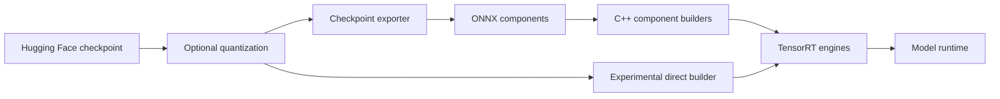

# Overview

TensorRT Edge-LLM is NVIDIA's C++ inference runtime for generative models on
NVIDIA Jetson, NVIDIA DRIVE, and NVIDIA DGX Spark. It supports text, image,
audio, speech, and action workflows while keeping the deployment runtime free
of Python dependencies.

See the [support matrix](user_guide/getting_started/support-matrix.md) for the
release software stacks and [supported models](user_guide/getting_started/supported-models.md)
for checkpoint IDs.

## Supported Platforms

TensorRT Edge-LLM officially supports NVIDIA Jetson Thor, NVIDIA DRIVE Thor,
NVIDIA DGX Spark (GB10), and NVIDIA Jetson Orin release targets. Jetson Orin
supports FP16, INT8, and INT4 model precisions; FP8 KV cache uses FP16 attention.

### Supported Model Families

For exact JetPack, DriveOS, CUDA, TensorRT, and TensorRT Edge-LLM version
compatibility, see the [Official Support Matrix](user_guide/getting_started/support-matrix.md).
For model and precision coverage, see [Supported Models](user_guide/getting_started/supported-models.md).

TensorRT Edge-LLM supports the deployment of a wide selection of LLM/VLM/Omni/VLA checkpoints with speculative decoding draft support, including Qwen, Llama, InternVL, Phi, Gemma, Nemotron, Alpamayo, Cosmos, etc.

---

## Key Features

- **🚀 High Performance**: Optimized CUDA kernels and TensorRT integration for minimum latency
- **💾 Memory Efficient**: Supporting 4-bit quantization for reduced memory footprint, with [FP8 KV cache](user_guide/features/FP8KV.md) support for additional memory savings
- **🔄 Production Ready**: C++-only runtime with no Python dependencies, designed for deployment on edge devices
- **🎯 Edge Optimized**: Built specifically for NVIDIA Jetson, DRIVE, and DGX Spark platforms with platform-specific optimizations
- **📊 Complete Toolkit**: End-to-end workflow from checkpoint export to C++ runtime, with engine builder and examples

## Deployment Workflows

TensorRT Edge-LLM provides two engine frontends. Both produce artifacts consumed
by the same C++ runtimes.

| Frontend | Command | Use it for |
|---|---|---|
| ONNX workflow | `trtedge export`, then component C++ builders | Supported deployment path, portable intermediate artifacts, and explicit component control |
| Direct frontend | `trtedge build` | Experimental on-device compilation directly from a local checkpoint |

Quantization is optional. Unquantized and supported pre-quantized checkpoints can
be compiled directly; use `trtedge quantize` only to create a new
quantized checkpoint.

## Runtime Capabilities

- Paged attention, FP8 KV cache, LoRA, streaming, [KV Cache Reuse](user_guide/features/kv-cache-reuse.md), and [Skip-Softmax Attention](user_guide/features/skip-softmax.md) for long-context prefill
- EAGLE3, MTP, DFlash, and DSpark speculative decoding on supported models
- Image and audio encoders, speech generation, ASR, and action generation
- Model-specific runtimes for pipelines whose I/O contract is not LLM-shaped
- Python API and OpenAI-compatible server over the C++ runtime,
  with opt-in [In-Flight Batching](user_guide/features/in-flight-batching.md)

Feature availability depends on the model and deployment.

## Use it with other software

The OpenAI-compatible server is the endpoint for existing benchmark, evaluation,
and coding tools. A model ID is enough: the checkpoint downloads into the
normal Hugging Face cache, and the compiled engine is reused from the default
Edge-LLM cache.

- [AIPerf](user_guide/examples/integration/aiperf.md) measures streaming latency and throughput.
- [NeMo Evaluator](user_guide/examples/integration/nemo-evaluator.md) runs chat evaluations such as MMLU.
- [VLMEvalKit](user_guide/examples/integration/vlmevalkit.md) scores image, video, and text benchmarks such as MMStar, OCRBench, and MMMU.
- [Claude Code](user_guide/examples/integration/claude-code.md), [OpenClaw](user_guide/examples/integration/openclaw.md), and [Codex](user_guide/examples/integration/codex.md) use the local server as their model.

The [integration guide](user_guide/examples/integration/index.md) lists each tool.

## Start Here

1. [Install TensorRT Edge-LLM](user_guide/getting_started/installation.md) — start with the recommended Python wheel.
2. [Follow Quick Start](user_guide/getting_started/quick-start-guide.md) — start a chat or launch an HTTP server with `trtedge`.
3. [Explore examples](user_guide/examples/index.md) — find examples for your model and task.

For implementation details, see the
[checkpoint exporter](developer_guide/software-design/checkpoint-export.md),
[direct builder](developer_guide/software-design/onnxless-builder.md), and
[C++ runtime](developer_guide/software-design/cpp-runtime-overview.md) design guides.
