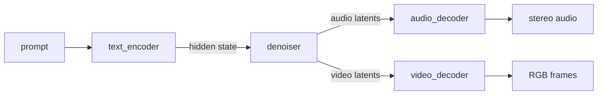

# MiniMax-H3

[MiniMax-H3](https://huggingface.co/MiniMaxAI/MiniMax-H3) generates video with stereo audio from a
text prompt. Edge-LLM runs the text-to-video-and-audio task of the official checkpoint in FP16; no
other checkpoint or precision is supported.

`trtedge build` turns the Diffusers checkpoint into four engines and a
[stage graph](../../developer_guide/software-design/multi-stage-graph.md), and `multistage_inference`
or the Python `MultiStageRuntime` runs the graph in one process:



| Stage | Engine | Role |
|---|---|---|
| `text_encoder` | `text_encoder/text_encoder.engine` | Hidden state after layer 50 of the Qwen3-VL text tower |
| `denoiser` | `gen/gen.engine` | Token refiner and one denoising step over the packed text, audio, and video rows; one step per call |
| `audio_decoder` | `audio_decoder/audio_decoder.engine` | Stereo 32 kHz waveform |
| `video_decoder` | `vae_decoder/vae_decoder.engine` | One 256x256-pixel, 28-frame tile of the video VAE; one 17-frame clip per call |

## 1. Download the Checkpoint

Accept the [MiniMax H3 Community License](https://huggingface.co/MiniMaxAI/MiniMax-H3/blob/main/LICENSE),
then download the checkpoint onto the device:

```bash
export CHECKPOINT=$HOME/tensorrt-edgellm-workspace/MiniMax-H3/checkpoint
hf download MiniMaxAI/MiniMax-H3 --local-dir "$CHECKPOINT"
```

The `text_encoder` and `gen` engines hold no weights: at load time the runtime reads their FP16
weights from this directory, so keep the checkpoint at this path, on a local disk, after the build.

## 2. Build Edge-LLM

Follow [Installation](../getting_started/installation.md) for the C++ runtime. The default CuTe DSL
kernel build includes the block-sparse attention kernel that the denoiser uses on Blackwell GPUs.
For the Python API, also complete the optional Python frontend step, which builds the runtime
bindings with `-DBUILD_PYTHON_BINDINGS=ON`.

Run the commands below from the repository root, where the build placed `build/bin` and `build/lib`.

```bash
export ENGINE_DIR=$HOME/tensorrt-edgellm-workspace/MiniMax-H3/engines
```

## 3. Build the Engines

```bash
trtedge build --model-dir "$CHECKPOINT" --engine-dir "$ENGINE_DIR"
```

The build writes the four engines, a `config.json` next to each, the tokenizer next to the text
encoder, and `multistage_config.json`, which names the stages and the edges between them.

The timestep branch of the denoiser depends only on the sampling schedule, so the build evaluates
it once for every step and stores the results in the GEN engine; the engine runs the step count it
was built for. Two options set the GEN engine:

| Option | Default | Meaning |
|---|---|---|
| `--minimax-h3-num-steps` | 50 | Denoising steps |
| `--minimax-h3-max-video-tokens` | 40960 | Video latent rows per request; 1344x768 at 124 frames needs 37296 |

Prompts can have up to 4096 tokens. When the plugin library has no `SparseAttentionPlugin` for the
GPU, the build logs a warning and the GEN engine uses dense TensorRT attention, which is slower.

To check the graph against the runners of your build without loading any engine, run:

```bash
./build/bin/multistage_inference --config "$ENGINE_DIR" --validate-config
```

## 4. Generate a Video

### Command line

```bash
mkdir -p out
./build/bin/multistage_inference --config "$ENGINE_DIR" \
  --prompt "A red paper airplane flies through a sunlit classroom." \
  --style '{"height": 768, "width": 1344, "num_frames": 124}' \
  --sampling '{"seed": 0}' \
  --out-video out/video.rgb --out-audio out/audio.wav
ffmpeg -f rawvideo -pix_fmt rgb24 -video_size 1344x768 -framerate 24 -i out/video.rgb \
  -i out/audio.wav -c:v libx264 -pix_fmt yuv420p -c:a aac out/video.mp4
```

`--out-video` receives the frames as raw 8-bit RGB and `--out-audio` the 16-bit stereo waveform.
A request without `--out-video` skips the video decoder.

| Field | Default | Limits |
|---|---|---|
| `height`, `width` in `--style` | 768, 1344 | Multiples of 32, at least 256, at most 1344x768 pixels, aspect ratio within 4:1 |
| `num_frames` in `--style` | 124 | Rounded up to 17n + 5 frames at 24 fps |
| `seed` in `--sampling` | 0 | Seed of the initial noise |

### Request file

A request file names the prompt and these fields per request:

```json
{"requests": [{"prompt": "A red paper airplane flies through a sunlit classroom.",
               "height": 768, "width": 1344, "num_frames": 124, "sampling": {"seed": 0}}]}
```

```bash
./build/bin/multistage_inference --config "$ENGINE_DIR" \
  --input-file requests.json --output-file predictions.json \
  --output-video-dir out --output-audio-dir out --dump-profile
```

Request `<i>` writes `out/video_req<i>.rgb` and `out/audio_req<i>.wav`; `predictions.json` records
the frame count, size, and frame rate of each video, and `--dump-profile` reports the GPU time of each
stage (`minimax_h3_text_encoder`, `minimax_h3_denoise_step`, `minimax_h3_audio_decode`, and
`minimax_h3_video_decode`) and the peak memory.

### Python

`examples/python/minimax_h3_text_to_video.py` builds the engines on its first run, generates one
video, and writes `minimax_h3.mp4` and `minimax_h3.wav`:

```bash
python examples/python/minimax_h3_text_to_video.py \
  --checkpoint "$CHECKPOINT" --engine-dir "$ENGINE_DIR" \
  --prompt "A red paper airplane flies through a sunlit classroom."
```

Its core is the `MultiStageRuntime` binding, which runs any stage graph. With an installed wheel,
`runtime.load()` returns the native module; the example also finds the module of a source build under
`build/lib`:

```python
import json

import numpy
from tensorrt_edgellm import runtime

graph = runtime.load().MultiStageRuntime(engine_dir)
result = graph.generate("A red paper airplane flies through a sunlit classroom.",
                        style=json.dumps({"height": 768, "width": 1344, "num_frames": 124}),
                        sampling=json.dumps({"seed": 0}))
frames = numpy.frombuffer(result.video_rgb8, numpy.uint8).reshape(
    result.video_frames, result.video_height, result.video_width, 3)
audio = numpy.frombuffer(result.audio_pcm16, numpy.int16).reshape(-1, result.audio_channels)
```

`generate()` runs the same stages as `multistage_inference`, so the same prompt, style, and seed give
the same frames and waveform.

## Memory and Performance

Every stage claims its device and pinned memory, its execution-context memory, and, for the text
encoder and the denoiser, the checkpoint weights when the graph loads; a request allocates no device
or pinned memory. Per request, the runtime copies the prompt tokens and the RoPE positions to the
device, and each decoded clip and the waveform back to the host. The text encoder and the denoising
loop run without a host synchronization; the decoders synchronize once per clip to hand its frames
to the caller.
