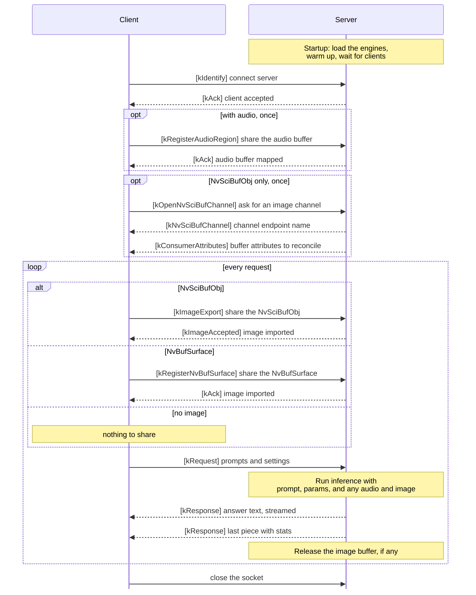

# Zero-copy multimodal inference server

A multimodal inference service on the same machine based on TensorRT Edge-LLM: clients send prompts and optional NV12 + PCM over a Unix socket; one `media_ipc_server` process loads TensorRT Edge-LLM engines and runs inference on a background worker thread.

## Highlights

- **Zero-copy media input.** Clients share NV12 frames through NvBufSurface or NvSciBufObj buffers, which the server maps directly into CUDA, and share PCM audio through a memfd region. Only short control messages cross the socket; the image and audio data are never copied between processes.
- **Low transport latency.** On Jetson AGX Thor with Qwen3-Omni-30B-A3B-Instruct, a single client sending 7 image and audio requests measured a transport overhead (client round trip minus server inference time) of 0.71 ms on average and 1.41 ms at most.
- **One server, multiple clients.** A single `media_ipc_server` loads the engines once and serves several client processes, streaming each client its own results.

## Comparison with the OpenAI-compatible server

TensorRT Edge-LLM also ships an [OpenAI-compatible HTTP server](../../docs/source/developer_guide/software-design/openai-server.md). Choose this example when the media already lives in device buffers on the same machine; choose the HTTP server for standard API clients and tools.

| | This example | OpenAI-compatible server |
| --- | --- | --- |
| Interface | C++ client over a Unix socket and NvSciIpc, using the messages in `message/message.h` | HTTP with OpenAI-compatible JSON |
| Media input | NV12 frames in NvBufSurface or NvSciBufObj buffers, f32 PCM in shared memory, all zero-copy | Images and audio as files or URLs in the request, decoded by the server |
| Clients | Processes on the same machine | Any HTTP client, local or remote |
| Concurrency | One request at a time, in arrival order | Optional [in-flight batching](../../docs/source/user_guide/features/in-flight-batching.md) |
| Implementation | C++ on `LLMInferenceRuntime` | Python on the Edge-LLM runtime |

## Support and limitations

- **Platforms:** Jetson and DRIVE OS, where NvSci is available. Validated on Jetson AGX Thor (JetPack 7.2).
- **Models:** Validated with Qwen3-Omni-30B-A3B-Instruct (thinker plus audio and visual encoders).
- **Inputs per request:** a text prompt and optional system prompt, plus optionally at most one NV12 frame (pitch-linear or block-linear) and at most one 16 kHz mono f32 PCM clip. Video input is not supported.
- **Output:** text only, streamed or returned in one piece.
- **Scheduling:** the server runs one request at a time with batch size 1. In-flight batching is not supported yet; with several clients, requests wait in a queue, so the client round trip includes that waiting time. Each client keeps at most one request in flight.
- **Speculative decoding** (EAGLE, MTP, and others) and **LoRA** are not supported yet. The Edge-LLM runtime provides both, but this example loads only a single base engine; support can be added in future work.

## Requirements

- **TensorRT Edge-LLM C++ build prerequisites** — see [Installation](../../docs/source/user_guide/getting_started/installation.md)
- **NvSci (`libnvscibuf`, `libnvsciipc`)** — required to build (client and service); the **NvSciBuf**
  frame path also needs `nvscistream_*` endpoint pairs in `/etc/nvsciipc.cfg` (the server logs how many
  pairs it can open at startup)
- **Optional NvBufSurface** (Jetson Multimedia API) — detected automatically at configure time; when
  found, clients may also use the **NvBufSurface** frame path
- **Engines built by the same TensorRT Edge-LLM checkout** (e.g. Qwen3-Omni thinker + multimodal audio/visual)
- **FFmpeg** — only to prepare the dataset below
```bash
sudo apt install ffmpeg
```

## Prepare the dataset

Convert the sample image to raw NV12 and the sample speech to 16 kHz mono f32 PCM for the client's `--image` and `--audio` options. All commands in this guide run from the TensorRT Edge-LLM repository root.

```bash
export LLM_SDK_DIR=/path/to/TensorRT-Edge-LLM
cd $LLM_SDK_DIR
mkdir -p examples/media_ipc_server/data
ffmpeg -i examples/multimodal/pics/giant_panda.jpeg -pix_fmt nv12 -f rawvideo \
  examples/media_ipc_server/data/giant_panda_1000x1000.nv12
ffmpeg -i examples/multimodal/audio/6930-75918-0000.flac -ac 1 -ar 16000 -f f32le \
  examples/media_ipc_server/data/speech_f32le_16000hz_mono.raw
```

## Build

From `$LLM_SDK_DIR`, enable `BUILD_MEDIA_IPC_SERVER` and build the two targets. The plugin library the server loads is built with them.

```bash
cmake -S . -B build -DTRT_PACKAGE_DIR=$TRT_PACKAGE_DIR -DBUILD_MEDIA_IPC_SERVER=ON
cmake --build build --target media_ipc_server media_ipc_client
```

## Run

Run from `$LLM_SDK_DIR`. The binaries are in `build/bin/`.

### run the server

```bash
./build/bin/media_ipc_server \
  --llm-engine-dir /path/to/engines/thinker \
  --multimodal-engine-dir /path/to/engines/multimodal
```

### run the client

The client sends only the inputs it is given. With no options, it sends a text-only request:
```bash
./build/bin/media_ipc_client
```

An image and audio request with every parameter:
```bash
./build/bin/media_ipc_client \
  --image examples/media_ipc_server/data/giant_panda_1000x1000.nv12:1000x1000:NV12_PL:0 \
  --audio examples/media_ipc_server/data/speech_f32le_16000hz_mono.raw \
  --prompt "Describe the image, then transcribe the speech." \
  --systemPrompt "You are a helpful multimodal assistant." \
  --iterations 10 --temperature 0.8 --topP 0.8 --topK 50
```

| Option | Purpose | Default |
| --- | --- | --- |
| `--image SPEC` | `PATH:WxH:NV12_PL\|NV12_BL:BufferType`, where BufferType `0` = NvSciBufObj, `1` = NvBufSurface | No image |
| `--audio PATH` | f32le mono PCM, 16 kHz | No audio |
| `--prompt TEXT` | User prompt | `Briefly introduce yourself.` |
| `--systemPrompt TEXT` | System prompt; pass `--systemPrompt ""` to send none | `You are a helpful multimodal assistant. Answer concisely.` |
| `--iterations N` | Number of requests to send, one after another | `1` |
| `--temperature X` | Sampling temperature | `0.8` |
| `--topP X` | Top-p sampling threshold | `0.8` |
| `--topK N` | Top-k sampling size | `50` |
| `--help` | Usage | |

### client output log

The answer is printed to stdout as it streams; everything else goes to stderr. A run with `--iterations 2` prints:

```text
edgellm-ipc: grep server log for "client <pid>:<fd>"
<answer 1>

perf: requestId=1 client_round_trip_ms=… server_inference_ms=… isl=… osl=…

<answer 2>

perf: requestId=2 client_round_trip_ms=… server_inference_ms=… isl=… osl=…

2 requests sent and answered
```

- **client `<pid>:<fd>`** — this client's id in the server log
- **requestId** — client per-request id, echoed on every server response to match responses and logs
- **client_round_trip_ms** — `kRequest` sent → last `kResponse` with `finished=1`
- **server_inference_ms** — same value as server log, carried on the terminal chunk
- **isl** — input sequence length: prompt tokens after chat template and image / audio expansion
- **osl** — output sequence length: generated tokens

## Client / Server sequence

The client puts each image and audio clip in memory shared with the server, so the media is never copied
between the two processes; only short control messages travel over the connection. Each client asks one
question at a time and waits for the full answer before sending the next request.



The `k`-prefixed messages are defined in [message/message.h](message/message.h). `kConsumerAttributes`,
`kImageExport` and `kImageAccepted` travel over the NvSciIpc channel; all others over the Unix socket.

## Architecture

| File | Role |
| --- | --- |
| `server/inferenceServer.cpp` | `media_ipc_server` CLI, TensorRT Edge-LLM init and warmup, `Server::run` |
| `server/ipcServer.h` | Unix socket, PCM mmap, frame import, request queue, worker thread (`handleRequest`, streaming), reply outbox |
| `server/nvBufToCuda.h` | NvSciBuf / NvBufSurface → CUDA `ImageData` (once per frame request) |
| `client/exampleClient.cpp` | `media_ipc_client` CLI: load the inputs, send requests, print the answers |
| `client/ipcClient.h` | Reference sender |
| `client/mediaSource.h` | Allocate NV12 buffers and copy the image / PCM into them |
| `message/message.h` | Message definitions shared by client and server (`StreamChunkDesc` carries `serverInferenceMs`, `inputTokens` and `outputTokens` on the last chunk) |

## Where to read next

- [message/message.h](message/message.h) — message definitions: each message type, its fields, and the order they are sent in
- [server/ipcServer.h](server/ipcServer.h) — to produce frames and run inference in the same process, follow `NvBufToInfer-1..4`: map your NvSciBufObj / NvBufSurface to `ImageData`, build `LLMGenerationRequest`, attach a `StreamChannel` if streaming, call `handleRequest`
